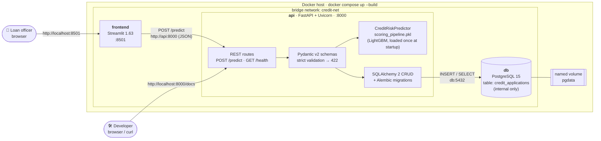
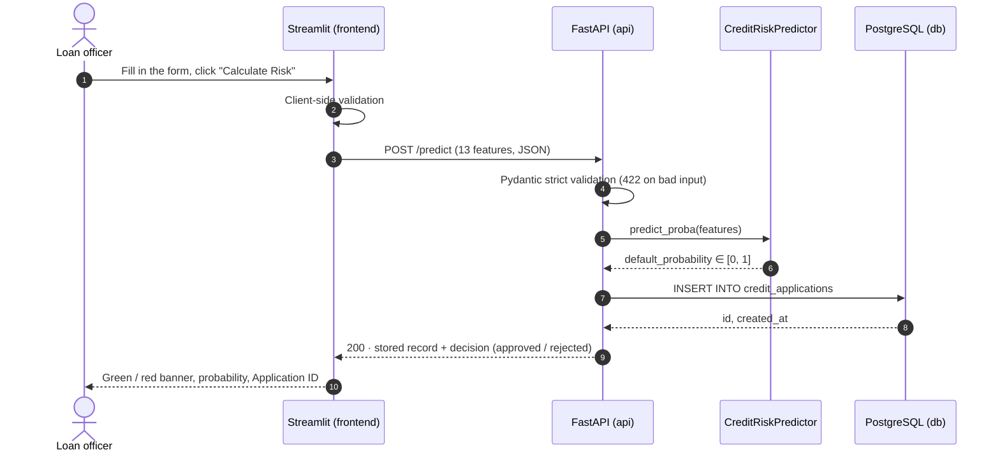
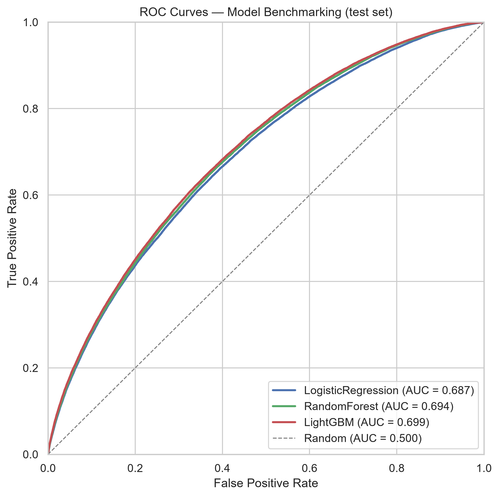

# Credit Risk Service

[](https://github.com/K-mavromatis/credit-risk-service/actions/workflows/ci.yml)


An end-to-end Machine Learning microservice that estimates the **probability of default** of a loan applicant. A LightGBM model trained on the [Lending Club dataset](https://www.kaggle.com/datasets/wordsforthewise/lending-club) (1.35 M resolved loans) is served by a FastAPI REST API. Every scored application is stored in PostgreSQL, and a Streamlit UI gives loan officers a form to work with.

**Contents:** [Architecture](#architecture) · [Quick start](#quick-start-docker) · [REST API](#rest-api) · [Model metrics](#model-metrics) · [Configuration](#configuration) · [End-to-end verification](#end-to-end-verification) · [Local development](#local-development-without-docker) · [Project structure](#project-structure) · [Known limitations](#known-limitations) · [Roadmap](#development-roadmap) · [Team](#core-team)

---

## Architecture

Three containers on one isolated Docker bridge network (`credit-net`). Containers reach each other by service name. Only the UI and the API are published to the host, and the database is reachable only from inside the network.



**Request flow for one application (`POST /predict`):**



**Startup order** is enforced by healthchecks, so no service talks to a dependency that is not ready:

1. `db` starts and becomes *healthy* once `pg_isready` succeeds over TCP.
2. `api` runs `alembic upgrade head`, loads `scoring_pipeline.pkl`, starts Uvicorn and becomes *healthy* once `GET /health` answers.
3. `frontend` starts.

| Service | Image / build | Host port | Responsibility |
| :--- | :--- | :--- | :--- |
| `frontend` | `frontend/Dockerfile` (python:3.11-slim) | `8501` | Loan application form, decision banner, scoring history page |
| `api` | `Dockerfile`, multi-stage (python:3.11-slim) | `8000` | Validation, model inference, persistence, OpenAPI docs |
| `db` | `postgres:15-alpine` + `pgdata` volume | — (internal) | Stores every scored application |

---

## Quick start (Docker)

**Prerequisites:** Docker Desktop (or Docker Engine) with Compose v2, Git, and free ports `8000` and `8501`.

```bash
git clone https://github.com/K-mavromatis/credit-risk-service.git
cd credit-risk-service
cp .env.example .env            # one-time: creates the local config (git-ignored)
docker-compose up --build       # or: docker compose up --build
```

`.env` is required because Compose refuses to start the database without `POSTGRES_PASSWORD`. The template's placeholder values work as they are for a local demo. Change `POSTGRES_PASSWORD` for anything else.

The first build takes a few minutes (it installs scikit-learn, LightGBM and Streamlit). Later builds reuse the cached dependency layers. When all three services report healthy:

| What | URL |
| :--- | :--- |
| Streamlit UI | http://localhost:8501 |
| Swagger UI (interactive API docs) | **http://localhost:8000/docs** |
| ReDoc | http://localhost:8000/redoc |
| OpenAPI schema | http://localhost:8000/openapi.json |
| Health check | http://localhost:8000/health |

Useful commands:

```bash
docker compose ps                     # status + health of each service
docker compose logs -f api            # follow API logs (migrations, model load)
docker compose exec db psql -U postgres -d credit_scoring_db   # SQL shell
docker compose down                   # stop, keep the database volume
docker compose down -v                # stop AND delete the database volume
```

---

## REST API

Base URL: `http://localhost:8000` · version `0.4.0` · full interactive contract in **[Swagger UI](http://localhost:8000/docs)**.

| Method | Path | Tag | Description | Responses |
| :---: | :--- | :--- | :--- | :--- |
| `POST` | `/predict` | scoring | Validates one application, scores it with the model, stores it in PostgreSQL and returns the stored record with its decision. | `200` stored record · `422` invalid input · `500` model failed · `503` model not loaded / DB unavailable |
| `GET` | `/health` | monitoring | Liveness probe. Touches neither the DB nor the model, so it is cheap enough for frequent container probes. | `200` |
| `GET` | `/docs` | — | Swagger UI | `200` |
| `GET` | `/redoc` | — | ReDoc | `200` |
| `GET` | `/openapi.json` | — | OpenAPI 3 schema | `200` |

### `POST /predict`: request body

All 13 fields are the raw model features. Validation is **strict**: no type coercion (`"10000"` is not a number), unknown fields are rejected, and `NaN`/`inf` are rejected.

| Field | Type | Constraint | Example |
| :--- | :--- | :--- | :--- |
| `loan_amnt` | float | 500 – 40 000 USD | `10000.0` |
| `term` | enum | `"36 months"`, `"60 months"` | `"36 months"` |
| `purpose` | enum | 14 LendingClub purposes, e.g. `debt_consolidation`, `credit_card` | `"debt_consolidation"` |
| `annual_inc` | float | > 0 USD | `60000.0` |
| `dti` | float | ≥ 0 (%) | `18.0` |
| `emp_length` | int \| null | 0 – 10 (10 = 10+ years), `null` = unknown | `5` |
| `home_ownership` | enum | `MORTGAGE`, `RENT`, `OWN`, `OTHER` | `"MORTGAGE"` |
| `verification_status` | enum | `Source Verified`, `Verified`, `Not Verified` | `"Source Verified"` |
| `fico_range_low` | int | 300 – 850 | `700` |
| `open_acc` | int | ≥ 0 | `10` |
| `pub_rec` | int | ≥ 0 | `0` |
| `revol_util` | float | ≥ 0 (%; can exceed 100) | `50.0` |
| `mort_acc` | int \| null | ≥ 0, `null` = unknown | `1` |

### Example

```bash
curl -s -X POST http://localhost:8000/predict \
  -H "Content-Type: application/json" \
  -d '{"loan_amnt": 10000.0, "term": "36 months", "purpose": "debt_consolidation",
       "annual_inc": 60000.0, "dti": 18.0, "emp_length": 5, "home_ownership": "MORTGAGE",
       "verification_status": "Source Verified", "fico_range_low": 700, "open_acc": 10,
       "pub_rec": 0, "revol_util": 50.0, "mort_acc": 1}'
```

<details>
<summary>PowerShell equivalent</summary>

```powershell
$body = @{
  loan_amnt = 10000.0; term = "36 months"; purpose = "debt_consolidation"
  annual_inc = 60000.0; dti = 18.0; emp_length = 5; home_ownership = "MORTGAGE"
  verification_status = "Source Verified"; fico_range_low = 700; open_acc = 10
  pub_rec = 0; revol_util = 50.0; mort_acc = 1
} | ConvertTo-Json
Invoke-RestMethod -Method Post -Uri http://localhost:8000/predict `
  -ContentType "application/json" -Body $body
```
</details>

Response (`200 OK`): the request fields plus the values the server adds:

```json
{
  "loan_amnt": 10000.0, "term": "36 months", "purpose": "debt_consolidation",
  "...": "the other request fields",
  "id": 42,
  "default_probability": 0.137,
  "created_at": "2026-10-19T09:15:00Z",
  "decision": "approved"
}
```

`decision` is `"rejected"` when `default_probability >= RISK_THRESHOLD` (default `0.5`), otherwise `"approved"`. The UI applies the same rule, so the API decision and the UI banner always agree.

`GET /health` → `{"status": "ok", "version": "0.4.0", "model_loaded": true}`

---

## Model metrics

Hold-out evaluation on a stratified, leakage-safe 80/20 split. Train: 1,076,280 loans, test: 269,070 loans, default rate 19.97 %. Training and model selection are in [`notebooks/03_model_benchmarking.ipynb`](notebooks/03_model_benchmarking.ipynb). The highest ROC-AUC model is serialized to `src/ml_model/scoring_pipeline.pkl` (scikit-learn 1.9.0, LightGBM 4.7.0).

### Served model

<!-- METRICS:START -->
| Model | ROC-AUC | PR-AUC | Precision | Recall | F1 |
|---|---:|---:|---:|---:|---:|
| **LGBMClassifier** (`scoring_pipeline.pkl`) | 0.699 | 0.367 | 0.308 | 0.645 | 0.417 |

Test set: 269,070 loans, default rate 20.0%. Precision / Recall / F1 are for the *default* class at the API decision threshold `RISK_THRESHOLD = 0.5`. Generated by `python -m scripts.evaluate_model --update-readme`.
<!-- METRICS:END -->

The table above is generated from the committed model by [`scripts/evaluate_model.py`](scripts/evaluate_model.py), so the numbers in the README cannot drift from the pickle. Precision and Recall are measured at the same threshold `POST /predict` uses for its `decision`. They describe the API's actual approve/reject behaviour, not an arbitrary cut-off.

### Benchmark (model selection)

| Model | ROC-AUC | PR-AUC | F1 | Fit time |
|---|---:|---:|---:|---:|
| **LightGBM** (selected) | **0.699** | **0.367** | **0.417** | 11 s |
| Random Forest | 0.694 | 0.360 | 0.412 | 122 s |
| Logistic Regression | 0.687 | 0.352 | 0.408 | 29 s |
| *No-skill baseline* | 0.500 | 0.200 | — | — |

All three models use `class_weight="balanced"` on the same `ColumnTransformer` (median/most-frequent imputation, scaling, one-hot encoding). LightGBM wins on every metric and trains ~10× faster than Random Forest.

<p align="center"></p>

> **Interpretation.** ROC-AUC ≈ 0.70 is a typical baseline for application-time-only LendingClub features. These are the 13 fields a borrower provides, with no bureau history or behavioural data. The model ranks risk meaningfully but is **not calibrated** and has **no out-of-time validation** yet. Treat it as a baseline scoring engine, not a production credit-decision system. See [Known limitations](#known-limitations).

---

## Configuration

All settings are environment variables. [`.env.example`](.env.example) is the committed template, and `.env` is your local, git-ignored copy. Secrets are never baked into images: `.env` is excluded by `.dockerignore` and injected by Compose at runtime.

| Variable | Used by | Default | Purpose |
| :--- | :--- | :--- | :--- |
| `POSTGRES_USER` | db, api | `postgres` | Database superuser created on first start |
| `POSTGRES_PASSWORD` | db, api | **required** | Database password (keep it URL-safe: no `@ : / ?`) |
| `POSTGRES_DB` | db, api | `credit_scoring_db` | Database name |
| `DATABASE_URL` | api, Alembic (local runs only) | — | Full SQLAlchemy URL. In Docker the api builds it from `POSTGRES_*` with host `db` |
| `DB_ECHO` | api | `false` | Log every SQL statement (debug only) |
| `DB_POOL_SIZE` / `DB_MAX_OVERFLOW` | api | `5` / `10` | SQLAlchemy connection pool |
| `CORS_ORIGINS` | api | `http://localhost:8501,http://127.0.0.1:8501` | Browser origins allowed to call the API |
| `CORS_ORIGIN_REGEX` | api | any port on localhost | Extra origin regex for development; empty disables it |
| `API_BASE_URL` | frontend | `http://localhost:8000` | API address. In Docker it is set to `http://api:8000` |
| `RISK_THRESHOLD` | api, frontend, `evaluate_model` | `0.5` | P(default) at or above which an application is rejected |

Under Docker Compose only `POSTGRES_*`, `DB_*` and `RISK_THRESHOLD` are passed into the containers, and `DATABASE_URL` / `API_BASE_URL` are set by `docker-compose.yml` itself. The CORS variables take their defaults there. Setting them in `.env` affects local (non-Docker) runs only.

---

## End-to-end verification

A clean-room run that proves a fresh clone builds, scores and persists data with no manual setup beyond `.env`. Run it before every demo.

**0. Preconditions**
- [ ] All Sprint 5 branches are merged into `main` and pushed. The clone pulls from GitHub, not from your working copy.
- [ ] Docker Desktop is running, and ports `8000` and `8501` are free.
- [ ] The dev stack is stopped. The Compose project name is fixed (`name: credit-risk-service`), so a clone in another folder would reuse the same containers **and the same database volume**. For a truly clean run, remove it: in your dev copy run `docker compose down -v`. This deletes locally stored test applications only.

**1. Clone into a throw-away folder**

```bash
cd "$(mktemp -d)"                                   # PowerShell: cd $env:TEMP
git clone https://github.com/K-mavromatis/credit-risk-service.git credit-risk-e2e
cd credit-risk-e2e
git ls-files src/ml_model/scoring_pipeline.pkl      # must print the path: model is in git
cp .env.example .env
```

**2. Build and start with the single command**

```bash
docker-compose up --build
```

- [ ] The build finishes without errors. Optionally run `docker compose build --no-cache` first to skip cached layers.
- [ ] The `api` logs show `alembic upgrade head` → `Running upgrade -> 1b4951074b27` and then `Credit scoring pipeline loaded.`
- [ ] In a second terminal, `docker compose ps` shows `db`, `api` and `frontend` as **healthy**.

**3. Check the API**
- [ ] http://localhost:8000/health returns `"model_loaded": true`.
- [ ] http://localhost:8000/docs opens Swagger UI, which lists `POST /predict` and `GET /health`.
- [ ] Optional: *Try it out* on `POST /predict` with the prefilled example returns `200`. Changing `"term"` to `"48 months"` returns `422`.

**4. Check the database before scoring** (baseline row count)

```bash
docker compose exec db psql -U postgres -d credit_scoring_db -c "SELECT count(*) FROM credit_applications;"
```

- [ ] The count is `0` on a clean volume. If it is not `0`, write the number down.

**5. Score an applicant in the UI**
- [ ] Open http://localhost:8501, fill in the **New Application** form, and click **Calculate Risk**.
- [ ] A green (*Credit approved*) or red (*High default risk*) banner appears with the probability of default.
- [ ] Note the **Application ID** shown, e.g. `#1`.

**6. Prove the record was physically written to PostgreSQL**

```bash
docker compose exec db psql -U postgres -d credit_scoring_db -c "SELECT id, loan_amnt, annual_inc, fico_range_low, default_probability, created_at FROM credit_applications ORDER BY id DESC LIMIT 5;"
```

- [ ] The row count went up by exactly 1.
- [ ] A row with the same `id` as the UI exists, with the form's values and the same `default_probability`.
- [ ] Optional persistence check: `docker compose restart db`, run the query again, and the row is still there (named volume).

> If you replaced `POSTGRES_USER` / `POSTGRES_DB` in `.env`, use your values in the `psql` commands. pgAdmin cannot connect from the host by design, because the `db` service publishes no port. Use `psql` through `docker compose exec` as shown.

**7. Tear down**

```bash
docker compose down -v      # containers, network and the test volume
cd .. && rm -rf credit-risk-e2e   # PowerShell: cd ..; Remove-Item -Recurse -Force credit-risk-e2e
```

---

## Local development (without Docker)

Requires Python **3.11**: `scikit-learn==1.9.0`, pinned to match the pickle, ships no 3.10 wheels. You also need a PostgreSQL instance.

```bash
python -m venv .venv && source .venv/bin/activate   # Windows: .venv\Scripts\activate
pip install -r requirements.txt
cp .env.example .env                                 # set DATABASE_URL to your local DB
alembic upgrade head                                 # creates credit_applications
uvicorn src.api.main:app --reload                    # http://127.0.0.1:8000/docs
streamlit run frontend/app.py                        # http://localhost:8501
```

Quality gates. CI runs the same checks on every push and PR to `main`:

```bash
ruff check . && ruff format --check .
pytest tests/                                       # DB tests use in-memory SQLite, no Postgres needed
pytest --cov=src --cov=frontend --cov-report=term-missing
python -m scripts.evaluate_model                    # model metrics (needs the local test split)
```

For the generator-based ingestion pipeline for large raw LendingClub files, see [PIPELINE.md](PIPELINE.md). For conventions, branching and commit style, see [CONTRIBUTING.md](CONTRIBUTING.md).

---

## Project structure

```text
credit-risk-service/
├── docker-compose.yml            # db + api + frontend, healthcheck-gated startup
├── Dockerfile                    # API image: multi-stage, non-root, HEALTHCHECK
├── .env.example                  # configuration template (no secrets)
├── .github/workflows/ci.yml      # ruff lint + format check + pytest
├── alembic/ , alembic.ini        # schema migrations (credit_applications)
├── frontend/
│   ├── Dockerfile                # Streamlit image
│   └── app.py                    # loan form, API client, history page
├── src/
│   ├── api/
│   │   ├── main.py               # FastAPI app, lifespan model loading, CORS, routes
│   │   └── schemas.py            # Pydantic v2 contract + decision rule
│   ├── db/
│   │   ├── database.py           # engine, session factory, get_db dependency
│   │   ├── models.py             # CreditApplication ORM model
│   │   └── crud.py               # create_application, get_recent_applications
│   └── ml_model/
│       ├── service.py            # CreditRiskPredictor (inference wrapper)
│       ├── scoring_pipeline.pkl  # trained sklearn Pipeline (ColumnTransformer + LightGBM)
│       └── streaming/            # lazy ingestion pipeline for large raw files
├── notebooks/                    # 01 data prep · 02 EDA · 03 benchmarking (+ figures/)
├── scripts/
│   ├── evaluate_model.py         # test-set metrics -> README table
│   └── make_dataset.py, compare.py   # streaming-pipeline benchmark
├── tests/                        # API, schemas, DB/CRUD, ML, frontend, pipeline
├── PIPELINE.md · CONTRIBUTING.md · REFACTORING.md
└── pyproject.toml · requirements.txt
```

Datasets in `src/ml_model/data/` (raw CSV ≈ 1.7 GB, processed parquet) are git-ignored and are not needed to run the service.

---

## Known limitations

- **Decision threshold is a placeholder.** `RISK_THRESHOLD = 0.5` has not been tuned to a business cost of false approvals vs. false rejections yet.
- **No calibration and no out-of-time validation.** The probabilities rank risk, but they are not calibrated default rates.
- **Training is notebook-only.** There is no `train.py`. `scoring_pipeline.pkl` is versioned in git and is reproduced by running notebooks 01 → 03.
- **The UI history page shows demo data.** The API has no history endpoint yet, even though `crud.get_recent_applications` exists. Use `psql` to inspect stored applications.
- **No authentication** on the API. The service is intended for an internal network.

## Development roadmap

- **Sprint 1 — done:** architecture, EDA, data preparation, model benchmarking and export.
- **Sprint 2 — done:** PostgreSQL integration, SQLAlchemy models, Alembic migrations, CRUD layer.
- **Sprint 3 — done:** Pydantic v2 schemas, FastAPI `/predict` with model + DB integration, CORS/Swagger, Streamlit ↔ API integration.
- **Sprint 4 — done:** ruff + pre-commit, ML unit tests, API integration tests, isolated DB tests, frontend fault tolerance, credit decision rule.
- **Sprint 5 — done:** multi-stage API Dockerfile, Docker Compose orchestration, GitHub Actions CI, model artifact versioning, documentation and end-to-end run.
- **Next:** history endpoint, threshold tuning, probability calibration, out-of-time validation, `train.py`.

## Core team

**Konstantinos Mavromatis**, *Machine Learning & Backend API*
* **Focus:** Data Analytics, ML Engineering, PostgreSQL
* **GitHub:** [@K-mavromatis](https://github.com/K-mavromatis)
* **LinkedIn:** [Kostas Mavromatis](https://www.linkedin.com/in/kostas-mavromatis-193171310/)

**Liza Zinkina**, *Frontend & UI Integration*
* **Focus:** Interface Design, Streamlit, API Integration
* **GitHub:** [@Liza0316](https://github.com/Liza0316)
* **LinkedIn:** [Liza Zinkina](https://www.linkedin.com/in/%D0%BB%D0%B8%D0%B7%D0%B0-%D0%B7%D0%B8%D0%BD%D0%BA%D0%B8%D0%BD%D0%B0-30796a336/)
